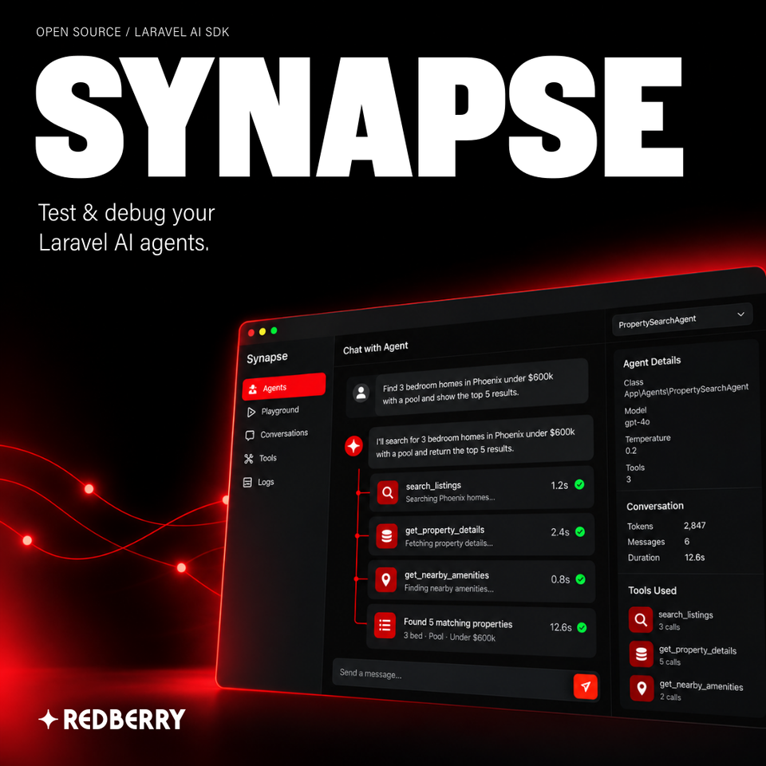

# Synapse

[](https://packagist.org/packages/redberry/synapse) [](https://packagist.org/packages/redberry/synapse) [](https://github.com/RedberryProducts/synapse/blob/main/LICENSE.md)

**See every connection your AI agents make.**

Synapse is an open-source development dashboard for agents built with the [Laravel AI SDK](https://github.com/laravel/ai). Chat with your agents in the browser, inspect their tool calls, and test approval flows while you develop.

**Built and maintained by [Redberry](https://redberry.international/?utm_source=github&utm_medium=referral&utm_campaign=synapse&utm_content=readme_intro), an official [Laravel Premier Partner](https://laravel.com/partners/redberry).**

[Website](https://redberry.international/open-source/synapse/?utm_source=github&utm_medium=referral&utm_campaign=synapse&utm_content=readme_navigation) • [Documentation](https://github.com/RedberryProducts/synapse#readme) • [Packagist](https://packagist.org/packages/redberry/synapse) • [Release notes](https://github.com/RedberryProducts/synapse/releases) • [Report an issue](https://github.com/RedberryProducts/synapse/issues)

**Contents:** [Features](https://github.com/RedberryProducts/synapse#what-you-can-do) • [Install](https://github.com/RedberryProducts/synapse#installation) • [Approvals](https://github.com/RedberryProducts/synapse#tool-approvals) • [Upgrade](https://github.com/RedberryProducts/synapse#upgrading-synapse) • [Configuration](https://github.com/RedberryProducts/synapse#configuration) • [Access](https://github.com/RedberryProducts/synapse#access-and-deployment) • [Support](https://github.com/RedberryProducts/synapse#documentation-and-support) • [Contribute](https://github.com/RedberryProducts/synapse#development)



*Promotional artwork with an illustrative dashboard.*

## Why Synapse

Developing an agent means changing instructions, running it again, and checking what happened. Synapse puts that loop in one browser workspace, with your agent’s current configuration, conversation history, tool arguments, results, and reported token usage together.

Use your existing Laravel AI SDK agents and provider settings. Synapse discovers class-based agents in your application and runs them through the playground, so you can inspect their behavior without building a separate chat interface.

Synapse records the conversations you run in its playground. It does not monitor your application’s production agent traffic. It runs class-based agents directly; anonymous agents, queued or broadcast invocation, and standalone SDK features such as embeddings, image generation, and transcription are outside the dashboard’s scope.

## Backed by Redberry

Synapse is built and maintained by [Redberry](https://redberry.international/?utm_source=github&utm_medium=referral&utm_campaign=synapse&utm_content=readme_backing), an official [Laravel Premier Partner](https://laravel.com/partners/redberry). Redberry develops the package and its documentation as part of its work on AI tooling for Laravel.

Created by [Revaz Ghambarashvili](https://github.com/MaestroError).

**Need help building your AI agent?** [Talk to Redberry](https://redberry.international/ai-agent-development/?utm_source=github&utm_medium=referral&utm_campaign=synapse&utm_content=readme_service_cta) about a five-week proof-of-concept sprint for your business workflow.

## What you can do

- **Discover your agents.** Find class-based agents in your configured directories and see their providers, models, and tools. Refresh to discover new agents; reload Octane workers after code changes.
- **Test in the chat playground.** Send messages, upload supported images, documents, or audio, and try another model for the next message without editing your agent’s code.
- **Inspect tool calls.** Expand inline cards to inspect arguments, returned results, execution time, and reported status. Provider-hosted tools are labelled separately.
- **Approve tools before execution.** Review supported SDK approval requests, approve or deny them, and continue the paused turn. Pending requests remain available after a refresh.
- **Inspect each model round.** Expand Steps beneath a saved response to inspect the provider, model, output, available reasoning, token usage, finish reason, and associated tools. Newly observed calls also show recorded model-call timing.
- **Follow cited sources.** Open source links reported by the provider through the SDK. Sources remain with the saved response when citation data is available.
- **Understand incomplete answers.** See notices for output token limits, content filtering, and explicitly reported cancellation, with partial output retained.
- **Check agent configuration.** Inspect resolved settings, system instructions, tool schemas, and middleware without leaving the dashboard.
- **Track token usage.** See reported input and output usage per response and across the conversation, with available cache and reasoning breakdowns.
- **Return to earlier tests.** Search, filter, reopen, rename, and delete saved conversations. Switch between light, dark, and system themes.
- **Diagnose failures.** Inspect inline exception details and stack traces, alongside partial output and completed tool work retained before the failure.

## Requirements

| Dependency | Supported version |
|---|---|
| PHP | 8.3 or later |
| Laravel | 12.62 or later within 12.x, or 13.15 or later within 13.x |
| Laravel AI SDK | laravel/ai ^1.3 |
| Laravel MCP if installed | laravel/mcp 1.1.0 or later |

Use a currently patched Laravel release. The versions above describe package compatibility, rather than a recommendation to deploy an older framework patch.

## Installation

Install Synapse as a development dependency, then run its installer:

```bash
composer require --dev 'redberry/synapse:^0.3.1'
php artisan synapse:install
```

Open **/synapse** in your local application. The installer publishes the configuration, runs Synapse’s migrations, and publishes the application provider that defines the access gate. It registers that provider from AppServiceProvider only in the local environment and while Synapse is installed.

Synapse uses your application’s **config/ai.php** for providers and API keys. Compiled dashboard assets ship with the package, so the host application needs no npm build or asset publishing step.

## Your first session

1. Open /synapse and select an agent from Discovery. By default, Synapse scans app/Ai/Agents and app/Agents for classes implementing the SDK’s Agent contract.
2. Send a message. Watch the response and expand tool cards to inspect the arguments and results.
3. Inspect the agent’s instructions and settings in the Info panel. Use Steps to examine recorded model rounds beneath a saved response.
4. Change your agent’s code, reload Octane workers if applicable, refresh, and run another test. Configuration remains in your Laravel application.

If you need an agent to start with, generate one using the Laravel AI SDK:

```bash
php artisan make:agent SupportAgent
```

## Tool approvals

Synapse displays approval requests when the Laravel AI SDK requires permission before a supported tool runs. Review the arguments and approval reason, then approve or deny the request. For multiple pending calls, decide on each request before continuing.

Configure approvals using the SDK’s **Approvable** contract and **InteractsWithApprovals** trait, or **requireApproval('Reason shown to the user')** on an SDK tool that supports it. Argument-dependent approval rules are evaluated for the actual call.

Pending approvals survive a page reload, and continuation updates the same answer and tool cards. Denied tools do not execute. The integration supports custom and SDK approval tools, SDK MCP wrappers, and approval before delegating to a sub-agent. Provider-hosted tool approvals and approval requests originating inside a child agent are outside its scope.

If execution is interrupted, reload and inspect the saved state before taking further action. Synapse does not automatically rerun a claimed tool execution that may already have produced side effects.

## Sources and response details

Sources appear when the provider supplies URL citation data through the SDK. Duplicate URLs are combined, and source links remain available after reload or approval continuation where the data was retained. Ordinary links in answer text or tool results are not converted into citations; source links do not establish that an answer is accurate.

Completion notices explain reported output limits, filtering, or cancellation without treating those outcomes as invocation errors. The Steps inspector shows recorded model rounds without running the agent or executing tools. Missing historical timing or completion data stays unavailable.

## Upgrading Synapse

**From 0.3.0:** update the package and reload any Octane workers. No new migrations, configuration changes, or history reset are required:

```bash
composer require --dev 'redberry/synapse:^0.3.1'
```

For Octane, use octane:reload with your running server as described in [Runtimes](#runtimes) below.

**From 0.2.0:** back up your database and pause access to Synapse while updating. This upgrade preserves history and attachments. Update the Composer constraint, publish the two additive migrations, and run them before reopening the dashboard:

```bash
composer require --dev 'redberry/synapse:^0.3.1' --with-all-dependencies
php artisan vendor:publish --tag=synapse-migrations
php artisan migrate
php artisan migrate:status
```

Rebuild cached configuration if your deployment uses it. Confirm the approval and step-observation migrations have run on the intended storage connection, then verify an existing conversation, a new approval flow, and the Steps inspector. Do not clear history for this upgrade. Old paused turns need a new turn, and older records only show details that were originally retained.

**From 0.1.x:** follow the separate legacy storage migration in the [upgrade guide](https://github.com/RedberryProducts/synapse/blob/main/UPGRADE.md), then complete the current 0.3 upgrade. The legacy procedure requires discarding Synapse history and attachments before changing dependencies. Back up anything you need to keep. That reset does not apply to existing 0.2 installations.

Read the [upgrade guide](https://github.com/RedberryProducts/synapse/blob/main/UPGRADE.md) for the full verification and rollback steps, and the [v0.3.1 release notes](https://github.com/RedberryProducts/synapse/releases/tag/v0.3.1) for the Octane fixes. The [v0.3.0 notes](https://github.com/RedberryProducts/synapse/releases/tag/v0.3.0) describe approvals, sources, completion notices, and step inspection.

## Configuration

Configure Synapse in **config/synapse.php**. The defaults cover local development; change discovery paths, extra model choices, storage, or retention when your application needs a different setup.

| Setting | Default | Purpose |
|---|---|---|
| enabled | Enabled outside production | Master switch. No Synapse routes are registered when false. Environment variable SYNAPSE_ENABLED. |
| ui.path | synapse | Dashboard path. Environment variable SYNAPSE_PATH. |
| ui.middleware | ['web'] | Middleware applied to Synapse routes, in addition to authorization outside local. |
| discovery.paths | app/Ai/Agents and app/Agents | Directories scanned for agent classes. |
| discovery.ignore | [] | Agent classes to hide from discovery. |
| playground.models | [] | Extra model choices alongside the agent’s model and its provider’s cheapest and smartest tiers. |
| storage.connection | Application default | Connection for Synapse tables. Environment variable SYNAPSE_DB_CONNECTION. |
| storage.attachments_disk | local | Disk for uploaded files. Environment variable SYNAPSE_ATTACHMENTS_DISK. |
| retention.auto_prune | false | Enable daily pruning. Environment variable SYNAPSE_AUTO_PRUNE. Laravel’s scheduler must be running. |
| retention.days | 7 | Age threshold when pruning runs. Environment variable SYNAPSE_PRUNE_DAYS. |

## Access and deployment

The playground invokes real agents, uses provider credits, and executes real tools. Tool code can write to your database or call external services. Synapse’s separate history storage does not isolate those actions.

In Laravel’s **local** environment, the dashboard is open without authentication. Outside local, every dashboard and API route requires authorization. Explicitly register the published application provider while Synapse is installed and configure its **viewSynapse** gate. Apply the authentication middleware appropriate to your environment.

For example, restrict the gate to approved users in your published provider:

```php
Gate::define('viewSynapse', function ($user) {
    return in_array($user?->email, [
        'you@example.com',
    ]);
});
```

Production routes are disabled unless **SYNAPSE_ENABLED=true** is explicitly set while the package is installed. The authorization requirement still applies when enabled.

For the standard production deployment, omit development dependencies:

```bash
composer install --no-dev
php artisan migrate --force
```

The current installer’s guarded provider registration lets Laravel boot without Synapse. Its published migrations and provider are self-contained, so application migrations can still run after the development package is removed.

**Older installations:** if Synapse’s application provider was added directly to bootstrap/providers.php, rerun synapse:install locally before deployment. This updates the registration without replacing your gate. If the installer cannot verify an existing registration, resolve the references it identifies and rerun it.

If older published migrations extend **SynapseMigration**, refresh them while Synapse is still installed:

```bash
php artisan vendor:publish --tag=synapse-migrations --force
```

Update the published application provider to extend **Illuminate\Support\ServiceProvider** and guard its **Redberry\Synapse\Synapse::auth(...)** call with **class_exists**, preserving your viewSynapse gate and following the current provider stub. Alternatively, remove the old provider registration before deploying without development dependencies. Follow the version-specific upgrade guide before making these changes.

## Conversation behavior and data

Conversational agents receive earlier Synapse turns. Stateless agents receive only the current message, although the dashboard displays their messages together. Structured-output agents use a single-shot request without earlier turns and display the result as JSON. Approval continuation resumes the paused turn.

Playground history is stored in **synapse_conversations**, **synapse_messages**, and **synapse_tool_invocations**. Synapse does not read or write the SDK’s conversation tables. Everyone authorized to use the same Synapse instance and database shares its history; conversations are not separated by user. For separate storage, configure a Laravel database connection and select it with SYNAPSE_DB_CONNECTION before installation.

Uploaded images, documents, and audio use **storage.attachments_disk** and are served through authorized routes. Accepted inputs depend on the provider and model. Video, remote attachment URLs, and provider-hosted file references are not supported in the playground.

Deleting a conversation also removes its stored attachments. Automatic pruning is off by default. Enable it through SYNAPSE_AUTO_PRUNE and run Laravel’s scheduler, or use the commands below. History deletion is blocked while a tool approval is running.

## Commands

| Command | What it does |
|---|---|
| php artisan synapse:install | Publish configuration, migrations, and the gate provider; register the provider locally and run migrations. Reruns preserve customized config and provider files. Use --no-migrate to skip migrations. |
| php artisan synapse:prune --days=7 | Delete conversations older than seven days and their attachments. Without --days, use the configured retention window. |
| php artisan synapse:clear | Delete all Synapse conversations and their attachments. |
| php artisan about | Show the installed version, enabled state, dashboard path, discovered-agent count, and retention setting. |

## Runtimes

Synapse v0.3.1 supports the runtime configurations below. The project’s [runtime test guide](https://github.com/RedberryProducts/synapse/blob/v0.3.1/tests/Runtime/README.md) records HTTP checks of streaming, saved history, tool execution, partial failures, and approval continuation.

| Runtime | Delivery in the qualified configuration |
|---|---|
| php artisan serve | Incremental streaming. |
| nginx with PHP-FPM | Incremental streaming with Synapse’s buffering header honored. |
| Laravel Sail with its default artisan serve command | Incremental streaming. |
| FrankenPHP in classic mode | Incremental streaming. |
| Octane with FrankenPHP | Incremental streaming on Synapse 0.3.1. |
| Octane with Swoole | Incremental streaming on Synapse 0.3.1. |
| Octane with RoadRunner | Conversations are recorded; responses arrive complete. Live streaming is unsupported. |

**Use Synapse 0.3.1 or later with Octane.** Version 0.3.0 can fail to save tool executions in Octane workers. No Synapse-specific listeners, service-provider bindings, or Octane warm/flush settings are required. Install Octane’s chosen server using [Laravel’s setup guidance](https://laravel.com/docs/octane), then install Synapse normally.

Reload workers after a package upgrade or agent-code change, choosing the engine you run:

```bash
php artisan octane:reload --server=frankenphp
# Or: php artisan octane:reload --server=swoole
# Or: php artisan octane:reload --server=roadrunner
```

Octane does not enable production access automatically. Structured-output agents still return a completed, single-shot response. The test matrix does not establish support for every host, proxy, or compression setup; Herd, Valet, and Forge deployments were not individually qualified. Preserve Synapse’s X-Accel-Buffering: no header and check any additional response buffering in your environment.

## Troubleshooting

**An agent is missing.** Confirm that its class implements the SDK’s Agent contract, lives in a configured discovery directory, and is not ignored. The default directories are app/Ai/Agents and app/Agents. Constructor failures appear as unavailable-agent diagnostics.

**Earlier messages are ignored.** Check whether the agent implements Conversational. Stateless and structured-output agents intentionally receive no earlier turns with a new prompt.

**The dashboard denies access outside local.** Register the published application provider and configure its viewSynapse gate. Production additionally requires explicitly enabling Synapse while the package is installed.

**New columns are missing after an update.** Publish Synapse’s migrations and run them using the commands in the upgrade section. Follow the guide for your installed version. Frontend assets do not require publishing.

**An approval remains unresolved after interruption.** Reload to inspect the stored state and check the tool’s outcome before recovery. A claimed execution is not automatically retried because it may already have acted.

## Documentation and support

This README covers the dashboard, configuration, data handling, access control, and troubleshooting. Check the [upgrade guide](https://github.com/RedberryProducts/synapse/blob/main/UPGRADE.md) before moving between release lines.

For reporting guidance, see [Support](https://github.com/RedberryProducts/synapse/blob/main/.github/SUPPORT.md). Report bugs and suggest features in [GitHub Issues](https://github.com/RedberryProducts/synapse/issues). For a bug report, include your Synapse, PHP, Laravel, and Laravel AI SDK versions, the steps to reproduce it, and the relevant error. Remove API keys, credentials, private prompts, and customer data before posting.

## Development

Contributions to Synapse’s code and documentation are welcome. Read the [contribution guide](https://github.com/RedberryProducts/synapse/blob/main/.github/CONTRIBUTING.md) before opening a pull request. For a substantial change, open an issue first to discuss the problem and proposed approach. Submit a focused pull request with relevant checks and reproduction or verification steps.

For work on Synapse itself, install the development dependencies and build the dashboard:

```bash
composer install
npm install
npm run build
```

Run the code checks and enable the repository hook:

```bash
composer check
composer hooks
```

Browser end-to-end tests require Playwright and run separately:

```bash
composer test:e2e
```

Compiled dashboard assets are committed in dist and served from the package. Read [DEV.md](https://github.com/RedberryProducts/synapse/blob/main/DEV.md) for the development workflow and the [repository guide](https://github.com/RedberryProducts/synapse/blob/main/AGENTS.md) for architecture and coding standards.

## Credits

Synapse was created by [Revaz Ghambarashvili](https://github.com/MaestroError) and is built and maintained by [Redberry](https://redberry.international/?utm_source=github&utm_medium=referral&utm_campaign=synapse&utm_content=readme_credits). Thanks to [everyone who contributes](https://github.com/RedberryProducts/synapse/graphs/contributors) to the package and its documentation.

Synapse works with the [Laravel AI SDK](https://github.com/laravel/ai), maintained by Laravel. Synapse is a Redberry package.

## License

Synapse is open-source software released under the [MIT license](https://github.com/RedberryProducts/synapse/blob/main/LICENSE.md).
